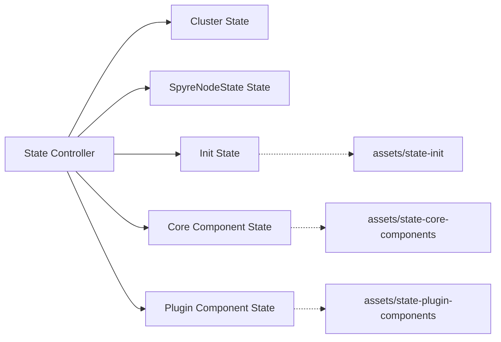
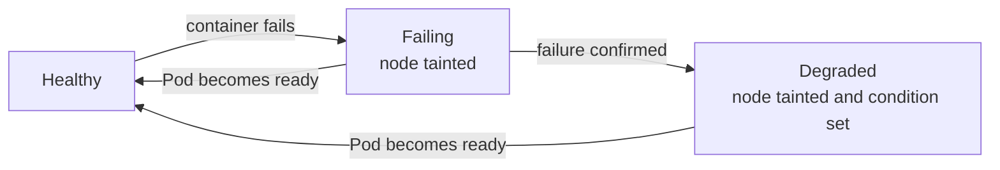
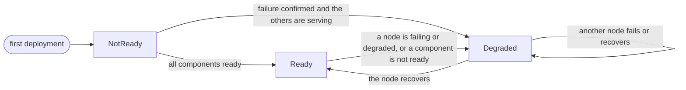

# State Controller

To operator Spyre card on the OpenShift, there are several components operates together.
State controller transforms and keeps syncing the deployment of each component in a deterministic order.

## High-Level Architecture

There are five states which have been controlled by the state controller those are

- **Cluster State**: a state contains information about common settings such as NodeFeatureDiscovery availability, node architecture, and enabled flags.
- **SpyreNodeState State**: a state contains status of SpyreNodeState resource corresponding to available Spyre nodes labeled by NodeFeatureDiscovery.
- **Init State**: a state contains initial components given in [state-init asset](../../assets/state-init) which are deployed first.
- **Core Component State**: a state contains core components given in [state-core-components asset](../../assets/state-core-components) which are deployed next from the init state.
- **Plugin Component State**: a state contains plugin components given in [state-plugin-components asset](../../assets/state-plugin-components) which are deployed last.

### Deployment state

The **Init State**, **Core Component State**, and **Plugin Component State** are collectively referred to as **Deployment States**.

Deployment states are processed **sequentially** in the following order:

1. Init State
2. Core Component State
3. Plugin Component State

Each state begins only after the previous state is fully **Ready**. If a state is not Ready, processing does not continue to the next state.
The only exception is a cluster whose previous state is `Ready` or `Degraded`, where a component which is not ready (e.g., a failing node) does not stop the Plugin Component State. See [Failing and degraded nodes](#failing-and-degraded-nodes).

During cleanup or deletion workflows, deployment states are processed in the **reverse order** to ensure safe teardown and dependency correctness.

A deployment state consists of one or more **components**.  All components within the same state are transformed based on the `SpyreClusterPolicy` and synchronized to the cluster in parallel.

- Admins can enable or disable deployment at the **component level**.
- A deployment state is considered **Ready** only when all its components are Ready.

Each component is composed of one or more deployable **objects** (Kubernetes resources).

- A component is Ready when all its objects have been deployed successfully.
- The objects of a component are synced in order. An object which is not ready blocks the next one, except for the objects of a node that is failing or degraded. See [Objects of a component](#objects-of-a-component).

## Component Descriptions

### State Controllers

The **state controllers** orchestrate the deployment workflow by dividing the system lifecycle into three phases: **Initialization**, **Core**, and **Additional Plugins**. This phased model ensures deterministic ordering, proper dependency management, and phase-level parallelism according to given `SpyreClusterPolicy`.

### Initialization Phase

Deploys baseline components required by all other phases.

### Core Phase

Deploys components essential to Spyre card configuration.

### Additional Plugin Phase

Deploys optional add‑on features.

### Component Enable/Disable & Reconciliation

- **Component-level toggle:** Each optional component has can be disabled.
  - When disabled, the controller ensures the component’s objects are **deleted** from the cluster.
  - When enabled, the controller ensures the component’s objects are **present** and **up to date**, except it is listed in **SkipUpdateComponents**.
- **Reconciliation on policy changes:**
  1. **Detect change** to `SpyreClusterPolicy` (create/update/delete).
  2. **Transform** desired state → concrete Kubernetes objects per component (templates + defaults + overrides).
  3. **Sync** to cluster:
     - If `enabled: true` → create/update objects (idempotent apply).
     - If `enabled: false` → delete objects (reverse alphabetical order to respect dependencies).
  4. **Status update:** Report ready condition back to `SpyreClusterPolicy.status`.

## Failing and degraded nodes

Every DaemonSet managed by the operator is a **degradable object**. A container of its Pod may keep failing on one node while the other nodes are healthy.
Instead of reporting the whole `SpyreClusterPolicy` as `NotReady`, the state controller isolates the node and reports `Degraded` so that the healthy nodes and the existing components keep serving.

### Node stages

A node moves through the following stages per component. The stages are decided from the status of the DaemonSet Pods, checked on every reconciliation.

| Stage | Condition | Node taint | Node condition | Meaning |
|---|---|---|---|---|
| **Healthy** | Pod is ready | no | no | Normal. |
| **Failing** | A container fails on creation (`CreateContainerConfigError`, `CreateContainerError`, `RunContainerError`, `InvalidImageName`), or exits with a non-zero code and has restarted at least once | yes | no | The failure may be transient. The node is held so that the later components are not newly deployed on it. |
| **Degraded** | A creation failure lasts over the grace period (1 minute), or a runtime crash has restarted the container at least 3 times (instantly, no grace period) | yes | yes | The failure is confirmed. It is reported in the `SpyreClusterPolicy`. |

- A Pod which is deleting is ignored because its failure is stale. A container which exits with code 0 is not a failure.
- The taint is `ibm.com/<component>-degraded:NoSchedule`, for example `ibm.com/spyre-device-plugin-degraded`.
- The node condition is `ibm.com/<Component>Degraded`, for example `ibm.com/SpyreDevicePluginDegraded`. It is set to `False` when the node recovers.
- Card management is also degraded when its Pod is unschedulable for the lack of Spyre devices on the node, over its own grace period (2 minutes).

### Holding the later components

The taint holds the later components and does not evict anything.

- A DaemonSet tolerates the taint of its own component and of all the components in the same and the later deployment states, so the failing component is able to recover and the earlier components keep running.
- A DaemonSet does not tolerate the taint of a component in an earlier state, so a new Pod of a later component is not scheduled on the node.
  For example, a failing device plugin (Core State) holds the plugin components (Plugin State), while the health checker (Init State) and the device plugin itself keep running.
- `NoSchedule` does not evict a Pod which is already running on the node. Eviction is not done on purpose.
- The taint and the condition are removed on the sync after the Pod becomes ready, when the component is disabled, and when the `SpyreClusterPolicy` is deleted.

| Failing component in | Still deployed on the node (tolerates the taint) | Held (not newly deployed) |
|---|---|---|
| Init State | Init components | Core and Plugin components |
| Core State | Init and Core components | Plugin components |
| Plugin State | Init, Core and Plugin components | none |

### Objects of a component

The objects of a component (e.g., ServiceAccount, DaemonSet, Service, ServiceMonitor) are synced in order, and an object which is not ready blocks the next one.
Some objects cannot become ready when a node is failing or degraded, so they are handled as follows to not block the rest of the component.

| Object | When it is not ready | Behavior |
|---|---|---|
| DaemonSet (degradable) | Pods are failing or degraded on some nodes | Does not block the next object, so the other nodes keep being synced. |
| DaemonSet (degradable) | No Pod is desired, because every node it is meant for is held by the taint of an earlier component | Regarded as settled, not pending. It cannot become ready until the node recovers. |
| Service | The DaemonSets behind it have no desired Pod | Regarded as ready. There is no endpoint, which is not a failure of the Service. |
| Service | A Pod is desired, but every unready DaemonSet of the component is degraded or held | Stays not ready, but does not block the next object (e.g., the ServiceMonitor), as it has no endpoint to wait for. |
| Service | A Pod is desired and some DaemonSet is still pending | Blocks the next object until the endpoint is ready. |

A component is successful when its last object is ready, or when every unready DaemonSet is degraded or held and none is pending.
A DaemonSet which is neither is pending (e.g., a new node is initializing) and the component is not successful.

### Policy state flow

`syncCoreAndPluginState` decides the `SpyreClusterPolicy` state from the **previous state** and the nodes found failing or degraded.

| Previous state | Situation | Plugin Component State | New state |
|---|---|---|---|
| any | all components ready | synced | `Ready` |
| any | all components successful, with confirmed degraded nodes | synced | `Degraded`, the message lists the nodes |
| `Ready` or `Degraded` | a component is not ready, e.g., a node is failing (not confirmed), a new node is initializing, or a rollout | synced | `Degraded`, the message lists the components and the held nodes |
| other than `Ready` and `Degraded` (e.g., first deployment) | a core component is not ready | **not synced** | `NotReady`, the message lists the components and the held nodes |
| other than `Ready` and `Degraded` | only a plugin component is not ready | synced | `NotReady` |

- **First deployment:** the Plugin Component State waits for the Core Component State, as the Core waits for the Init. A plugin Pod is not created on a node whose core component has not succeeded, because the taint cannot evict a Pod which is already running.
- **Running cluster:** the Plugin Component State keeps being synced when a component is not ready, so the components which are running are not interrupted. The policy moves from `Ready` to `Degraded`, not `NotReady`.
  The previous state is the only input. A cluster which was not `Ready` before stays `NotReady` until it is successful, even when a node is failing.
- **Single failing node:** if the only node is failing, the later components have no node to run on. They are settled as described in [Objects of a component](#objects-of-a-component), so the policy reports `Degraded` once the failure is confirmed instead of staying `NotReady`.
- **Confirmed failure:** the Core Component State counts as successful, so the Plugin Component State is synced on the healthy nodes while the degraded node is tainted.
