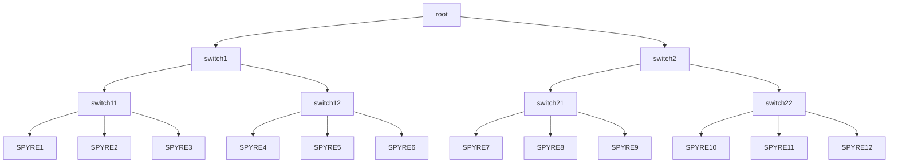
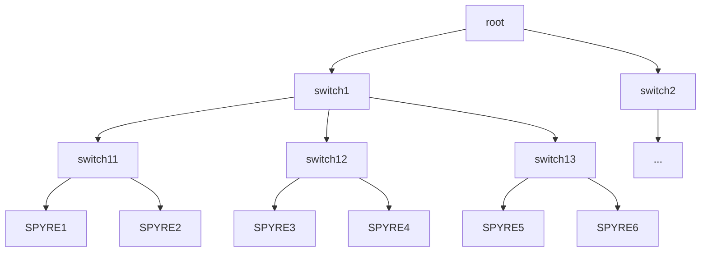

# IBM AIU Spyre Operator User Guide

## Table of Contents <!-- omit in toc -->

- [Quick Start](#quick-start)
- [Available Resource Names](#available-resource-names)
- [Allocation Modes](#allocation-modes)
  - [Simple Allocation](#simple-allocation)
  - [Per Device Allocation](#per-device-allocation)
  - [Topology Aware Allocation](#topology-aware-allocation)
    - [Running a Multi Spyre Job using `ibm.com/spyre_pf_tier0,tier1,tier2`](#running-a-multi-spyre-job-using-ibmcomspyre_pf_tier0tier1tier2)
- [Allocation with DRA](#allocation-with-dra)
  - [Simple Allocation with DRA](#simple-allocation-with-dra)
  - [Specific Device Allocation with DRA](#specific-device-allocation-with-dra)
  - [Topology Aware Allocation with DRA](#topology-aware-allocation-with-dra)

## Quick Start

To request for Spyres, there are two required field in the `PodSpec`:

- .spec.containers[].resources
- .spec.schedulerName

Here is an example Pod deployment requesting for a single Spyre.

```yaml
apiVersion: v1
kind: Pod
metadata:
  name: single-spyre-job
spec:
  schedulerName: spyre-scheduler
  containers:
    - name: app
      image: registry.access.redhat.com/ubi9/ubi:latest
      command: ["tail", "-f", "/dev/null"]
      resources:
        limits:
          ibm.com/spyre_pf: "1"     # requesting 1 Spyre
```

In addition to a simple request, there are the other advanced resource requests such as specifying a specific device or topology-aware device group where you can find more detail in the next section [Available Resource Names](#available-resource-names).

If specifying the target node is needed, do not use `.spec.nodeName`. Instead, users must use `.spec.nodeSelector` as below, where `worker-1` should be replaced with the desired node.

```yaml
spec:
  nodeSelector:
    kubernetes.io/hostname: worker-1
```

To confirm functionality, your pod should

- contain a resource pool name file `resource_pool`, a topology file `topo.json` and a configuration file `/etc/aiu/senlib_config.json` or `/etc/ibm/spyre/config.json`, depending on the admin's configuration. The configuration file must contain allocated device list in the `sen_bus_id`.

  ```shell
  $ ls -l /etc/aiu
  total 176
  -rw-r--r--. 1 root root      8 Aug  8 02:45 resource_pool
  -rw-r--r--. 1 root root    309 Aug  8 02:45 senlib_config.json
  -rw-r--r--. 1 root root 170397 Aug  8 02:45 topo.json
  ```

  ```shell
  $ cat /etc/aiu/senlib_config.json
  {"GENERAL":{"multi_aiu_config_path":"","sen_bus_id":["0000:29:00.0"],"target":"SOC"},"METRICS":{"general":{"enable":true,"path":"/data/sentientmap_0000:29:00.0","port":8082,"promclient":{"wakeup_interval_in_seconds":0}}},"RISCV":{"DOOM":{"enable":false}},"SNT_MCI":{"DCR":{"MCI_CTRL":{"ENABLE_RISCV":"0x0"}}}}
  ```

- have `PCIDEVICE_IBM_COM_AIU_PF` set to the allocated device list.

  ```shell
  $ env
  ...
  PCIDEVICE_IBM_COM_AIU_PF=0000:1a:00.0
  ...
  ```

## Available Resource Names

Available resource names are the pre-defined resource names those are available to be specified in the Pod's resources requests/limits. Here is the summary of resource allocation types.

| Name                                      | Allocation Mode                                                | Expected Users                                                                                                            | Description                                                                                                    |
| ----------------------------------------- | -------------------------------------------------------------- | ------------------------------------------------------------------------------------------------------------------------- | -------------------------------------------------------------------------------------------------------------- |
| `ibm.com/spyre_pf`                        | simpleAllocation **without card management enablement**        | All general users                                                                                                         | provides arbitrary **physical** Spyre cards in the node                                                        |
| `ibm.com/spyre_pf_{formatted pf card ID}` | perDeviceAllocation **without card management enablement**     | not recommended for general users.<br/>should be used only for card debug purpose by cluster admin or HW/Driver dev team. | provides a single **physical** Spyre card in a specific PCI address                                            |
| `ibm.com/spyre_pf_tier0`                  | topologyAwareAllocation **without card management enablement** | all users who want to run tensor parallel (TP) Job                                                                        | provides a largest set of available physical Spyre cards on the same PCI switch in the node                    |
| `ibm.com/spyre_pf_tier1`                  | topologyAwareAllocation **without card management enablement** | all users who want to run tensor parallel (TP) Job                                                                        | provides a largest set of available physical Spyre cards at most one hop away PCI switch in the node           |
| `ibm.com/spyre_pf_tier2`                  | topologyAwareAllocation **without card management enablement** | all users who want to run tensor parallel (TP) Job                                                                        | provides a largest set of available physical Spyre cards at most two hops away PCI switch in the node          |
| `ibm.com/spyre_vf`                        | simpleAllocation **with card management enablement**           | All general users                                                                                                         | provides arbitrary **virtual** Spyre cards in the node                                                         |
| `ibm.com/spyre_vf_{formatted pf card ID}` | perDeviceAllocation **with card management enablement**        | not recommended for general users.<br/>should be used only for card debug purpose by cluster admin or HW/Driver dev team. | provides a single **virtual** Spyre card which virtualized from the provided specific **physical** PCI address |

Card management component enables virtual cards. When this component is enabled, only **virtual cards** can be allocated. **Physical cards** cannot be allocated by general users.

For the resources with physical cards (pf), DOOM will be explicitly disabled in the generated config file.

Please further refer to the section [Allocation Modes](#allocation-modes) for the details of each allocation mode in the table.

## Allocation Modes

### Simple Allocation

If you are familiar with NVIDIA GPU allocation in OpenShift,`ibm.com/spyre_pf` behaves like `nvidia.com/gpu`.
That means, you can request arbitrary number of Spyre cards for your deployment by using `ibm.com/spyre_pf`.

### Per Device Allocation

> [!WARNING] This requires an experimental mode enablement—please check with the admin to see if it’s enabled.

By using `ibm.com/spyre_pf_{card_id}` in `perDeviceAllocation` mode, we can request a specific Spyre card in a particular PCI address.
This mode was originally prepared for debug purpose, such as getting a specific Spyre card for debugging purpose.

### Topology Aware Allocation

> [!WARNING] This requires an experimental mode enablement—please check with the admin to see if it’s enabled.

This mode supports users to request a special set of Spyre cards based on PCI topology.
By using this mode, we can guarantee to pick up Spyre cards of a particular class in the node. `Tier0` provides a set of cards in the same PCI switch.
`Tier1` provides a set of cards from at most on-hop away PCI switch. `Tier2` provides a set of cards from at most two-hops away PCI switch.

The topology-aware allocation strategy is changed to uniform distribution against `Tier0`. This allocation strategy is only applicable for the topology with binary branches (leaves can be non-binary).

- devices will be selected uniformly from its subtrees under assumption that the device tree is a binary tree

For example, given the device tree as below, a user pod requests 4x `Tier1` Spyre cards.
The devices will be divided into two groups, and each are selected from different `Tier0` groups - `{SPYRE1, SPYRE2, SPYRE4, SPYRE5}`, uniformly selected from `switch11` and `switch12`, are selected.



Note: the new strategy introduced following constraints.

1. `spyre_pf_tier1` only accepts one or even-number device requests (1, 2, 4,...)
2. non-binary branch topology such as below is not applicable.



#### Running a Multi Spyre Job using `ibm.com/spyre_pf_tier0,tier1,tier2`

This resource type is used for picking up a topology aware card set, which is required to run tensor parallel (TP) workloads more effectively.
By using `tierX` class resource, TP users can automatically get a best performing card set for the workload.

The maximum number of allocatable resources in each tier depends on the platform & cluster, but we can get up to 4 cards from `tier0`, 8 cards from `tier1`, and 16 cards from `tier2`.
If you specify `ibm.com/spyre_pf_tier0: 5` in your yaml, the pod will never be scheduled because the maximum set of cards in tier0 is 4.

Typically, we will use a fixed number of cards for TP workloads, such as 2, 4, 8, 16, etc., so you can use `ibm.com/spyre_pf_tier0` for TP=2 and TP=4,
`ibm.com/spyre_pf_tier1` for TP=8, and `ibm.com/spyre_pf_tier2` for TP=16.

```yaml
apiVersion: v1
kind: Pod
metadata:
  name: multi-spyre-job-tier0
spec:
  schedulerName: spyre-scheduler
  containers:
    - name: app
      image: registry.access.redhat.com/ubi9/ubi:latest
      command: ["tail", "-f", "/dev/null"]
      resources:
        limits:
          ibm.com/spyre_pf_tier0: "2"     # requesting 2 Spyres that belong to a same PCI switch.
```

## Allocation with DRA

> [!NOTE]
> This section applies only when the cluster administrator has enabled the [DRA driver](../admin-guide/dra-driver-guide.md) (`draDriver: true`) instead of the device plugin. Please check with the admin.
> With DRA, `ibm.com/spyre_pf*` resource names and `.spec.schedulerName: spyre-scheduler` are **not** used. Instead, a Pod references a `ResourceClaimTemplate` that describes the requested devices.

A DRA request consists of two objects in the same namespace:

1. a `ResourceClaimTemplate` describing which devices (and how many) are requested, and
2. a Pod that references the template through `.spec.resourceClaims` and uses it in `.spec.containers[].resources.claims`.

The `deviceClassName` in the template selects the type of device:

| DeviceClass           | Description                                                                                                                                                                                                 | Expected Users                                                             |
| --------------------- | ----------------------------------------------------------------------------------------------------------------------------------------------------------------------------------------------------------- | -------------------------------------------------------------------------- |
| `spyre-standard-vf`   | The general virtual function of a card for general workloads. No namespace restriction.                          | All general users                                                          |
| `spyre-pf`            | The physical function of a card. It may be a card that has been virtualized or a physical card. When it is virtualized, it is meant to be managed by the card management component and block general users from allocating PFs. | When card management is enabled: privileged namespaces only (e.g. `spyre-operator`), not for general users. Cards that are not virtualized and not managed by card management can be used by users. |
| `spyre-privileged-vf` | The  privileged virtual function of a card for the card management                                                                        | Privileged namespaces only. Not for general users.                         |

The examples below use `spyre-pf`. Ready-to-use manifests are available in the [`resourceclaimtemplates/`](resourceclaimtemplates/) folder.

### Simple Allocation with DRA

Request an arbitrary number of Spyre cards with `count` (default is `1`). This is the DRA equivalent of `ibm.com/spyre_pf: "N"`.

```yaml
apiVersion: resource.k8s.io/v1
kind: ResourceClaimTemplate
metadata:
  name: spyre-simple-claim
spec:
  spec:
    devices:
      requests:
      - name: spyre
        exactly:
          deviceClassName: spyre-pf
          count: 2                 # requesting 2 Spyres
---
apiVersion: v1
kind: Pod
metadata:
  name: simple-spyre-job
spec:
  containers:
    - name: app
      image: registry.access.redhat.com/ubi9/ubi:latest
      command: ["tail", "-f", "/dev/null"]
      resources:
        claims:
          - name: spyre
  resourceClaims:
    - name: spyre
      resourceClaimTemplateName: spyre-simple-claim
```

If the number of requested cards is larger than the number of available cards, the Pod stays in `Pending`.

Examples: [`simple-pf.yaml`](resourceclaimtemplates/simple-pf.yaml) (template) and [`pod.yaml`](resourceclaimtemplates/pod.yaml) (Pod).

### Specific Device Allocation with DRA

> [!WARNING]
> Like [Per Device Allocation](#per-device-allocation), this is intended for debugging purposes. Do not use it for general workloads.

Use a CEL `selectors` expression on the `pciAddress` attribute (domain `spyre.ibm.com`) to request the card at a particular PCI address. The Pod definition is the same as in the simple allocation, referencing this template instead.

```yaml
apiVersion: resource.k8s.io/v1
kind: ResourceClaimTemplate
metadata:
  name: spyre-specific-claim
spec:
  spec:
    devices:
      requests:
      - name: spyre
        exactly:
          deviceClassName: spyre-pf
          selectors:
          - cel:
              expression: |-
                device.attributes["spyre.ibm.com"].pciAddress == "0000:1a:00.0"
```

The PCI addresses of the cards in a node can be found in the `ResourceSlice` (see the next section), where each device is named after its PCI address with `:` and `.` replaced by `-` (e.g. `0000-1a-00-0`).
If the specified card does not exist or is already allocated, the Pod stays in `Pending`.

Example: [`specific-device.yaml`](resourceclaimtemplates/specific-device.yaml).

### Topology Aware Allocation with DRA

This is the DRA equivalent of [Topology Aware Allocation](#topology-aware-allocation) (`ibm.com/spyre_pf_tier0,tier1,tier2`) for running tensor parallel (TP) workloads.

Every Spyre device in the `ResourceSlice` carries three topology attributes (domain `spyre.ibm.com`). Devices that share the same attribute value can be co-allocated.

| Attribute    | Devices that share the same value        |
| ------------ | ---------------------------------------- |
| `tier0Group` | Connected through the same PCI switch    |
| `tier1Group` | Reachable within one additional PCI hop  |
| `tier2Group` | Reachable within two additional PCI hops |

The value of each attribute is the PCI address of the group representative (the lowest address in the group). For virtual cards, the groups are computed from the VF peers.

The following excerpt of a `ResourceSlice` (`kubectl get resourceslices -o yaml`, may require permission from the admin) shows two cards behind the same PCI switch and one card behind a different switch. Other attributes and capacities are omitted for brevity.

```yaml
apiVersion: resource.k8s.io/v1
kind: ResourceSlice
spec:
  driver: spyre.ibm.com
  devices:
  - name: 0000-1a-00-0
    attributes:
      pciAddress:
        string: "0000:1a:00.0"
      productId:
        string: "06a7"
      numaInfo:
        string: "0"
      tier0Group:           # same value as 0000-1c-00-0 -> same PCI switch
        string: "0000:1a:00.0"
      tier1Group:
        string: "0000:1a:00.0"
      tier2Group:
        string: "0000:1a:00.0"
  - name: 0000-1c-00-0
    attributes:
      pciAddress:
        string: "0000:1c:00.0"
      productId:
        string: "06a7"
      numaInfo:
        string: "0"
      tier0Group:
        string: "0000:1a:00.0"
      tier1Group:
        string: "0000:1a:00.0"
      tier2Group:
        string: "0000:1a:00.0"
  - name: 0000-3d-00-0
    attributes:
      pciAddress:
        string: "0000:3d:00.0"
      productId:
        string: "06a7"
      numaInfo:
        string: "0"
      tier0Group:           # different PCI switch -> different tier0 group
        string: "0000:3d:00.0"
      tier1Group:           # one extra hop -> same tier1 group as the others
        string: "0000:1a:00.0"
      tier2Group:
        string: "0000:1a:00.0"
```

In this example, `0000-1a-00-0` and `0000-1c-00-0` can be co-allocated at tier 0, while all three devices can be co-allocated at tier 1 or tier 2.

To request devices from the same group, add a `matchAttribute` constraint to the `ResourceClaimTemplate`. The example below requests 4 cards that sit behind the same PCI switch. Use `spyre.ibm.com/tier1Group` or `spyre.ibm.com/tier2Group` for a wider group. The Pod definition is the same as in the simple allocation, referencing this template instead.

```yaml
apiVersion: resource.k8s.io/v1
kind: ResourceClaimTemplate
metadata:
  name: spyre-tier0-claim
spec:
  spec:
    devices:
      requests:
      - name: spyre
        exactly:
          deviceClassName: spyre-pf
          count: 4
      constraints:
      - requests: ["spyre"]
        matchAttribute: spyre.ibm.com/tier0Group
```

> [!NOTE]
> If the requested `count` is larger than the largest group at the requested tier, the claim cannot be satisfied and the pod stays in `Pending`.
> The tier attributes are not published when no topology information is available for the node.
> Unlike `ibm.com/spyre_pf_tier*`, this does not apply the uniform distribution strategy described in [Topology Aware Allocation](#topology-aware-allocation).

Examples: [`topology-tier0.yaml`](resourceclaimtemplates/topology-tier0.yaml), [`topology-tier1.yaml`](resourceclaimtemplates/topology-tier1.yaml), [`topology-tier2.yaml`](resourceclaimtemplates/topology-tier2.yaml).
